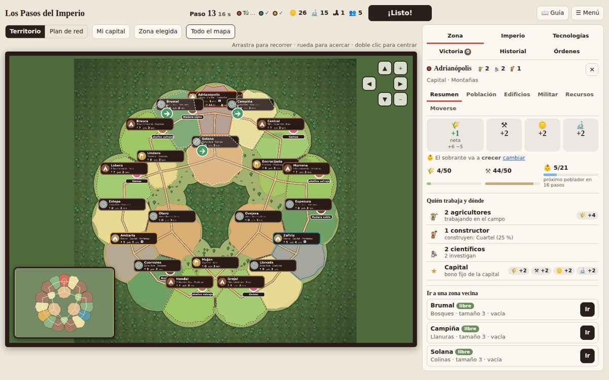
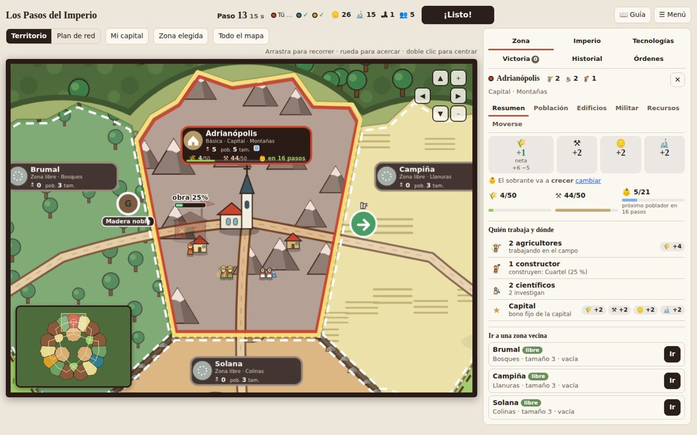
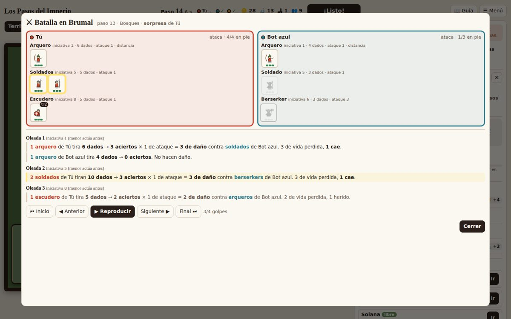
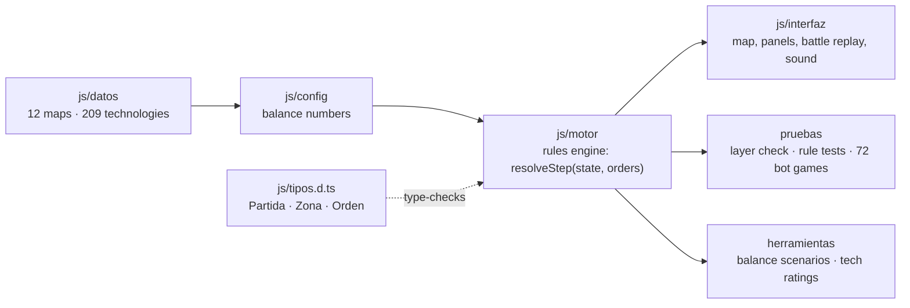

# Los Pasos del Imperio *(Steps of the Empire)*

**A simultaneous-turn strategy game built to play online with family.** Everyone plans **at the same time**; when all players press **Ready**, the step resolves and the map animates what happened. The goal: the fun of planning together under time pressure, without the micromanagement of a real-time strategy game.

▶ **[Play it in your browser](https://alejandroinfo.github.io/Imperial-steps/)**: no install, no account. *(The game's interface is in Spanish; it is made for our family.)*

🇪🇸 [Leer en español](README.es.md)



> **Status:** playable prototype v0.13 (against 1–3 bots, or online with 2–4 people; 12 maps). The rules design is mostly settled; the final engine will be ported to Python.

## What it shows

| Area | What is in the project |
|---|---|
| **Game design** | A full rule set (supply lines that make *where* you fight matter, frontier zones that create a prisoner's dilemma between neighbours, unannounced encounters that scale with the game, strategic resources that grow while held, populations and jobs, local and global economy, 10 buildings with levels, 209 technologies in 12 branches, initiative-based combat, tribes, events, 7 victory conditions), documented with decided / proposed / open markers in [`docs/Reglas_v0.1.md`](docs/Reglas_v0.1.md). |
| **Software architecture** | Four layers with a one-way dependency rule: `data → config → engine → interface`. The engine never touches the screen, so it runs headless in Node and can be ported to Python. |
| **Testing** | An automated layer check, 37 rule-level tests and a simulation of 72 bot-vs-bot games on every map, run with `npm test` and on GitHub Actions. |
| **Data & balance** | Simulators compare balance scenarios and rate all 209 technologies (economic payback and change in battle win rate); report in [`docs/balance_tecnologias.md`](docs/balance_tecnologias.md). |
| **UX** | Built and refined from play-testing: the technology panel recommends what helps most right now and previews each technology's impact on your current situation (e.g. “🌾 +3 per step”, computed by the engine itself), per-step suggestions, a zone summary of who works where, a step-by-step battle replay, procedurally generated sound effects and ambience (Web Audio, no audio files), and a map that reads as a landscape rather than a graph. |



## How to play

1. Open the game ([online](https://alejandroinfo.github.io/Imperial-steps/) or `index.html` locally). First time? Press **🎓 Comienzo guiado** (*guided start*): the first 20 steps of a real game introduce one system per step and highlight exactly what to click; then the game continues normally. Otherwise choose a map, the number of players and the victory mode, and press **Empezar** (*Start*).
2. Each step, give orders: specialize villagers into jobs (farmer, engineer, builder, scientist, merchant), build, research, move people, pay or annex tribes, or attack.
3. Press **¡Listo!** (*Ready*, or the Enter key). When everyone is ready, the step resolves.
4. Win by meeting **2 of 7 victory conditions at the same time** (gold, population, technology, territory, capitals, buildings, wonders).

Controls: drag to pan, scroll to zoom, double-click to center a zone; arrow keys or WASD also move the map. The **📖 Guía** button opens an in-game wiki.



## Play online

One player opens **🌐 Jugar en línea…** (*Play online*), creates a room and shares the 4-letter code or link; 2 to 4 people can join, and empty seats are played by bots. The host's browser runs the engine and, once everyone presses **¡Listo!**, resolves the step and publishes the full game state through **Firebase Realtime Database**, so every screen stays in sync and anyone can reload and rejoin their seat. Online play needs the game served from a web address (not opened as a local file) and a one-time Firebase setup of about 10 minutes: a project, a Realtime Database with the rules in `firebase/reglas_base_datos.json`, anonymous sign-in, and the values in `js/red/config_firebase.js`. See [`docs/multijugador.md`](docs/multijugador.md) (in Spanish).

## Run and test locally

No build step and no dependencies. Download the repository and open `index.html` in Chrome, Firefox or Edge.

```bash
npm test                                   # layer check + rule tests + network state + 72 simulated games
npm run check                              # TypeScript check of the engine (no build step)
npm run balance                            # balance scenarios and technology ratings
node pruebas/simular_partidas.js 10 80     # 10 seeds per map and player count, up to 80 steps
python herramientas/empaquetar.py          # bundle everything into one HTML file (dist/)
```

The tests need [Node.js](https://nodejs.org) 18 or newer. Randomness is seeded (`?seed=123` in the URL), so any game can be replayed exactly.

## Architecture



The dependency rule is one-way (`data → config → engine → interface`) and enforced by a test. The engine is pure game logic: it runs headless in Node for tests and simulations, and is type-checked with TypeScript through JSDoc and a declarations file, so there is no build step and the game still opens with a double click.

## Engineering highlights

- **Types that catch real bugs.** Every order the engine accepts is listed in a `Record<OrderType, …>`; when the type check was added it immediately showed that *wonder* orders were created by the interface but never handled, so wonders could not be built. Misspelled fields (`z.maravila`) are flagged before running anything.
- **Simulation-driven design.** Balance questions are answered with data: `herramientas/escenarios_balance.js` compares rule variants over dozens of bot games, and `herramientas/balance_tecnologias.js` rates all 209 technologies by economic payback and by change in battle win rate. Those reports led to concrete changes (cheaper troops, per-zone growth priority, frontier zones).
- **Reproducible games.** All randomness is seeded; any game or battle can be replayed exactly, and battles are recorded blow by blow for the in-game replay viewer.
- **Bugs found by tests and simulation**, each now covered by a test: workers counted twice across buildings, empty tribes that crashed annexation, a tribute raid from a tribe with no people.

## Project structure

```
index.html                  Page structure; loads the styles and scripts in order
css/estilos.css             All visual styling
js/
  datos/                    Pure data: the 12 maps and the 209 technologies
  config/                   Balance numbers: change the game without touching the engine
  motor/                    Game rules (engine). No access to the screen
    resolver_paso.js        resolveStep(state, orders): applies one full step
    economia.js             Production, automatic feeding, growth, healing
    combate.js              Initiative-wave combat, recorded blow by blow
    bots.js                 Computer players that use the same rules as humans
  interfaz/                 Everything you see and touch
    mapa/territorio.js      The valley map, camera and minimap
    paneles/                Side panels: zone, empire, technologies, victory, orders
    batalla.js              Battle replay viewer
    sugerencias.js          Per-step warnings and tips
  red/                      Online play: rooms, orders and shared state through Firebase
firebase/                   Security rules for the Realtime Database
pruebas/                    Layer check, rule tests, game simulator, network state and a two-browser online test
herramientas/empaquetar.py  Bundles the game into a single HTML file to share
docs/                       Rules, hand-off documents and how we work (in Spanish),
                            plus the balance reports and screenshots
```

How one step resolves: births → event → orders (research, specialize, train, build, send, annex) → movement → combat → zone control → economy → victory check.

## Design decisions

| Decision | Why |
|---|---|
| Simultaneous steps with a Ready button | Tension comes from deciding under pressure, not from mouse speed |
| No timer during play-tests | First measure how long people take; the game logs time-to-ready and orders per step |
| Captured civilians instead of killed ones | Slows down the runaway leader |
| Win with 2 of 7 conditions at once | Peaceful, aggressive and mixed paths, visible to everyone so rivals can react |
| Repetitive chores are automatic (feeding, research) | The interesting decisions are the ones each step, not upkeep |
| Engine separated from the interface | Testable without a screen and portable to Python with the same rules |
| All numbers in configuration tables | Balance without rewriting the engine |

## Roadmap

1. Play-test with family and decide what feels heavy.
2. Port the engine to **Python** with `pytest`, plus a balance simulator running thousands of games.
3. ~~Online multiplayer~~ ✅ done with Firebase (rooms with a code, reconnection); next, the first real family game.

## Team

Designed and built by **Alejandro**. How to contribute: [`CONTRIBUTING.md`](CONTRIBUTING.md).
